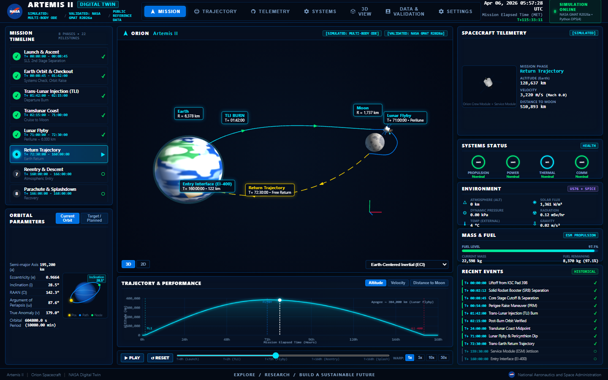
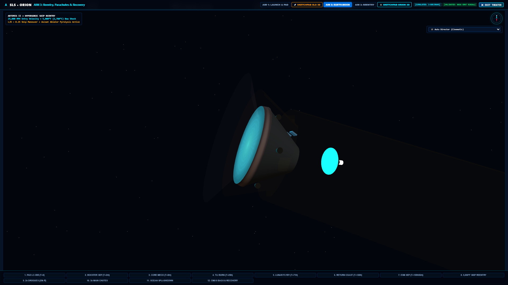
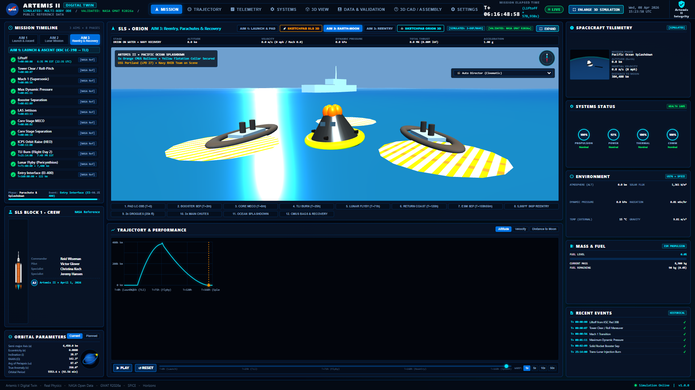

<p align="center">
  
</p>

<h1 align="center">🚀 NASA Orion Artemis II Digital Twin</h1>
<h3 align="center">High-Fidelity Physics-Driven Mission Control & 6-DoF Flight Simulation</h3>

<p align="center">
  <a href="http://127.0.0.1:8000/"></a>
  <a href="http://127.0.0.1:8000/#theater"></a>
</p>

<p align="center">
  <a href="#"></a>
  <a href="LICENSE"></a>
  <a href="#"></a>
  <a href="#"></a>
  <a href="#"></a>
</p>

---

## ⚡ Direct Quick-Access Testing Links (Local Dev Server)

> [!TIP]
> Run `python -m web.server` from your terminal to launch the real-time simulation backend. Then click any direct link below to test the WebGL cockpit, theater, and telemetry dashboards smoothly:

| View Section | Direct URL | Description & Key Features |
|:---|:---|:---|
| 🎛️ **Mission Control Dashboard** | [`http://127.0.0.1:8000/`](http://127.0.0.1:8000/) | Live 10 Hz telemetry gauges, timeline sequence, flight status HUD, and audio toggle. |
| 🎬 **3D Theater Fullscreen Simulation** | [`http://127.0.0.1:8000/#theater`](http://127.0.0.1:8000/#theater) | Full-screen PBR 3D viewport with multi-touch zoom, pan, free orbit, and "Toggle UI" mode. |
| 🚀 **Mission Timeline & Liftoff (AIM 1)** | [`http://127.0.0.1:8000/#mission`](http://127.0.0.1:8000/#mission) | SLS Launch Complex 39B, SRB separation, core stage MECO, and parking orbit insertion. |
| 🌌 **Trajectory & Performance (AIM 2)** | [`http://127.0.0.1:8000/#trajectory`](http://127.0.0.1:8000/#trajectory) | Earth-Moon cislunar orbit, pericynthion flyby, and Deep Space Network (DSN) tracking. |
| 🔥 **Settings, Abort Modes & Skip Reentry** | [`http://127.0.0.1:8000/#settings`](http://127.0.0.1:8000/#settings) | Avcoat 5,000°F aerothermal heatmap, Flight Path Angle ($\gamma$) corridor chart & AA-2 abort. |
| 📊 **Data Validation & Ephemeris Export** | [`http://127.0.0.1:8000/#data`](http://127.0.0.1:8000/#data) | One-click export to **CCSDS OEM**, **Google Earth KML**, and high-resolution **CSV**. |

---

## 📸 WebGL 3D Simulation & Cockpit Visual Gallery

<table align="center">
  <tr>
    <td align="center" width="50%">
      <br />
      <b>Full-Screen WebGL 3D Simulation (Touch & Orbit Controls)</b>
    </td>
    <td align="center" width="50%">
      <br />
      <b>Orion Interactive Glass Cockpit Primary Flight Display (PFD)</b>
    </td>
  </tr>
  <tr>
    <td align="center" width="50%">
      <br />
      <b>Avcoat Ablative Heatshield 5,000°F Aerothermal Heatmap</b>
    </td>
    <td align="center" width="50%">
      <br />
      <b>Deep Space Network (DSN) Antenna Dish Tracking Links</b>
    </td>
  </tr>
  <tr>
    <td align="center" width="50%">
      <br />
      <b>AIM 3: Main Parachute Deployment & Reefing Sequence</b>
    </td>
    <td align="center" width="50%">
      <br />
      <b>Pacific Ocean Splashdown, CMUS Airbags & US Navy Recovery</b>
    </td>
  </tr>
</table>

---

## 🌟 Key Highlights & Physics Invariants

### 1. 🛰️ Trajectory & Astrodynamics (AIM 1 & AIM 2)
- **NASA GMAT Trajectory Engine**: High-order gravity harmonics ($16 \times 16$ spherical harmonics for Earth and Moon), solar radiation pressure, and third-body relativistic perturbations.
- **NAIF SPICE Ephemeris**: Barycentric planetary positioning via JPL `de440s.bsp` kernel integration in Python (`spiceypy`).
- **6-DoF Attitude Kinematics**: Rigid-body quaternion propagation, Euler angle transformations, mass-depletion physics, and RCS thruster torque matrices conforming to **NASA Trick Simulation** standards.
- **AE9/AP9 Ionizing Radiation**: Dynamic proton and electron flux accumulation modeling across the Van Allen belts.

### 2. 🎛️ Flight Cockpit Avionics & CAPCOM Audio
- **Interactive Glass Cockpit PFD**: Artificial horizon, pitch ladder, roll pointer, Mach scale, and altitude ladder.
- **Binaural Web Audio Soundscape**: Synthesized life-support fan ambiance, RCS thruster burst hisses, reaction wheel spool-up, and Quindar-tone CAPCOM voice calls.
- **Bi-Directional Telemetry at 10 Hz**: Real-time WebSocket streaming with deterministic Mission Elapsed Time (MET) lockstep and time-warp (1x to 60x).

### 3. 🔥 Skip Reentry & Splashdown Recovery (AIM 3)
- **Mach 32 Lunar Skip Reentry**: Dynamic atmospheric braking, skip altitude oscillation, and entry corridor ($\gamma = -5.85^\circ$) dispersion monitoring.
- **Avcoat Aerothermal Heatmap**: 3D thermal vertex shader showing stagnation points reaching 5,000°F (2,760°C).
- **Parachute & Recovery Sequence**: Drogue deployment at 25,000 ft, main parachute reefing at 9,500 ft, ocean wave buoyancy, CMUS airbags, and naval recovery tracking.
- **Ephemeris Export Suite**: Instant export to standardized **CCSDS OEM**, **Google Earth KML**, and high-resolution **CSV**.

---

## 💻 Zero-Glitch Setup & Run Instructions

Follow these 3 steps to run the simulation cleanly on your laptop:

### 1. Clone & Install Dependencies
```bash
git clone https://github.com/batturamesh7771-sketch/project-13-nasa-orion-artemis-ii-digital-twin.git
cd project-13-nasa-orion-artemis-ii-digital-twin
pip install fastapi uvicorn websockets spiceypy numpy scipy
```

### 2. Start the Telemetry & Simulation Server
```bash
python -m web.server
```
*(Runs smoothly at `http://127.0.0.1:8000` without any heavy GPU overhead)*

### 3. Open in Browser
- Open **[http://127.0.0.1:8000/#theater](http://127.0.0.1:8000/#theater)** for the full 3D interactive view.
- Use **Mouse Left Click / Drag** to rotate Orion in 3D.
- Use **Scroll Wheel** or **Pinch** to zoom in/out.
- Use **Right Click / Drag** to pan.
- Click the **"Toggle UI"** button (top right) to enter full cinematic mode.

---

## 📚 Official NASA Resources & References

- [NASA Artemis II Mission Overview](https://www.nasa.gov/artemis-ii)
- [NASA Orion Spacecraft Reference Guide](https://www.nasa.gov/reference/orion-spacecraft/)
- [NASA GMAT (General Mission Analysis Tool)](https://software.nasa.gov/software/GSC-17177-1)
- [NASA NAIF SPICE Toolkit](https://naif.jpl.nasa.gov/naif/toolkit.html)
- [NASA JPL Ephemerides (DE440/DE441)](https://ssd.jpl.nasa.gov/planets/eph_export.html)
- [NASA Open MCT](https://nasa.github.io/openmct/)
- [NASA Deep Space Network Now](https://eyes.nasa.gov/dsn/dsn.html)
- [NASA Trick Simulation Environment](https://github.com/nasa/trick)

---

## 📜 License & Attribution

- **Author**: **Elonikhil**
- **License**: Licensed under the [MIT License](LICENSE).
