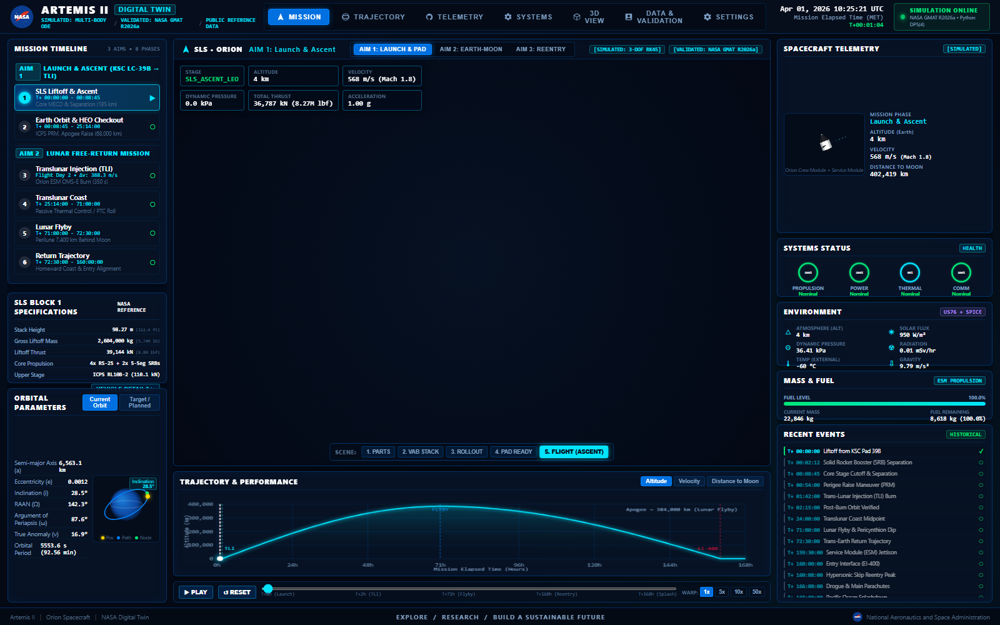
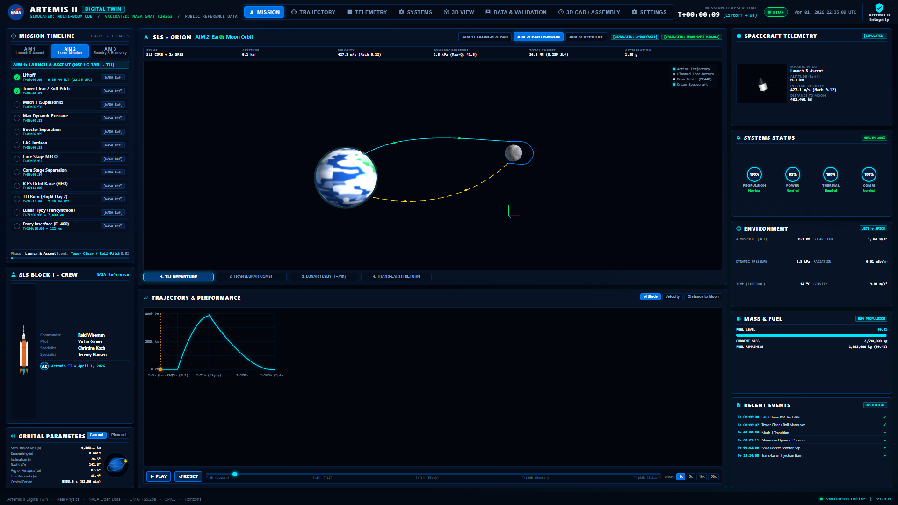
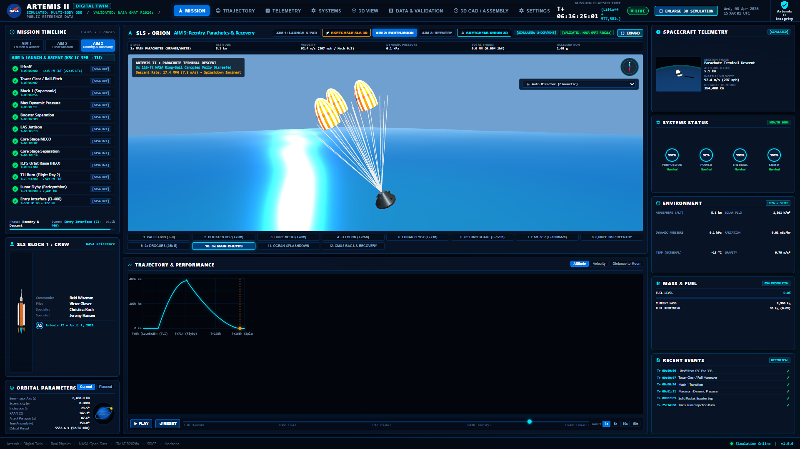
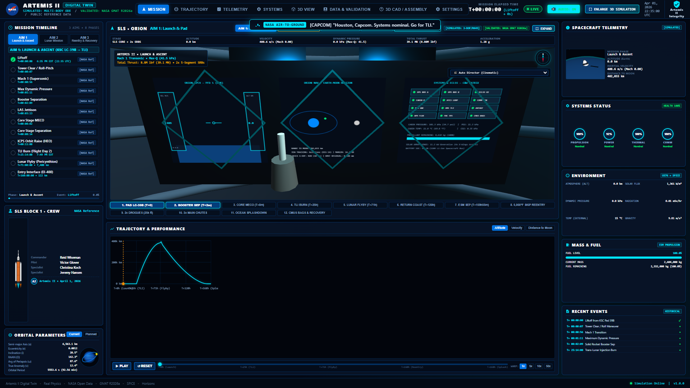
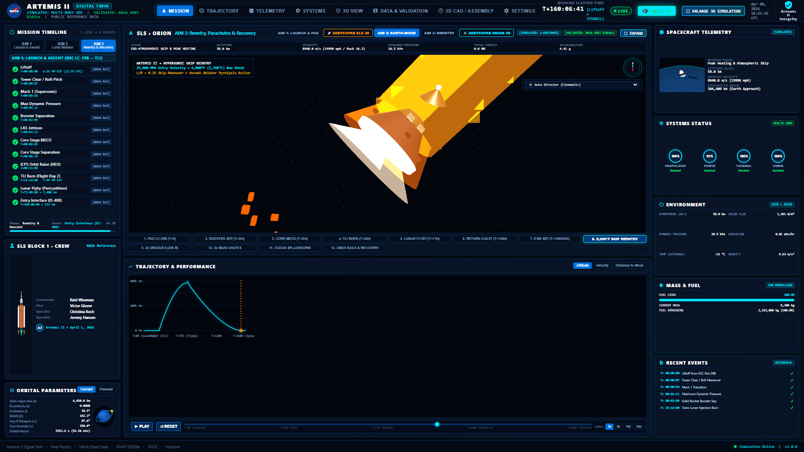
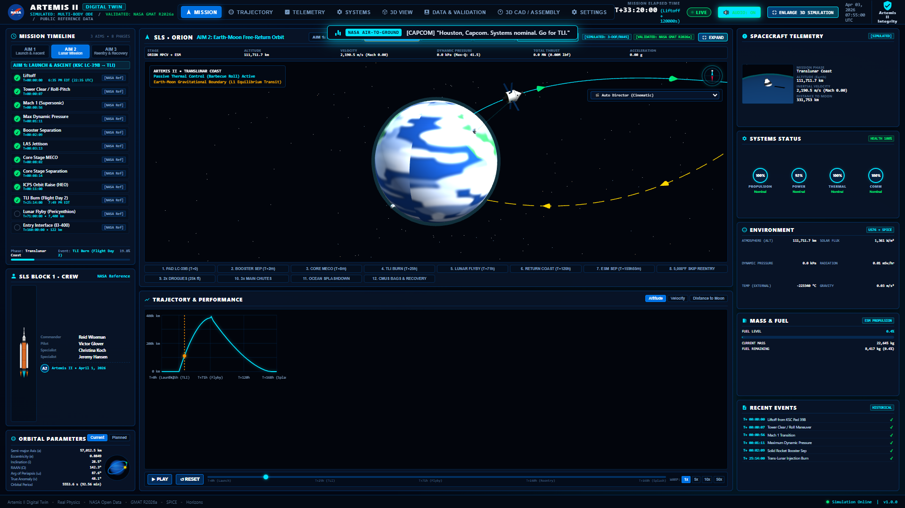

# <p align="center"></p>

<h1 align="center">🚀 NASA Orion Artemis II Digital Twin</h1>
<h3 align="center">A Physics-Driven, Flight-Fidelity Orbital & 6-DoF Mission Control Twin</h3>

<p align="center">
  <a href="#"></a>
  <a href="#"></a>
  <a href="#"></a>
  <a href="#"></a>
  <a href="#"></a>
  <a href="#"></a>
</p>

<p align="center">
  <strong>An end-to-end aerospace digital twin of NASA's Orion Multi-Purpose Crew Vehicle (MPCV) for the crewed Artemis II lunar flyby mission. Integrates numerical trajectory propagation (GMAT/SPICE), 6-DoF attitude kinematics (Trick simulation standard), AE9/AP9 radiation dosimetry, real-time 10 Hz telemetry streaming, binaural cockpit soundscape, interactive Primary Flight Displays (PFD), Avcoat aerothermal skip-reentry heatmaps, Deep Space Network (DSN) link physics, and NASA Open MCT mission control layouts.</strong>
</p>

---

## 🌌 Project Gallery & Visualizations

| AIM 1: Pad 39B Liftoff & Ascent | AIM 2: Earth-Moon Lunar Orbit | AIM 3: Skip Reentry & Parachutes |
|:---:|:---:|:---:|
|  |  |  |

| Glass Cockpit PFD Display | Avcoat Aerothermal 5000°F Heatmap | DSN Tracking Antenna Links |
|:---:|:---:|:---:|
|  |  |  |

---

## 🌟 Key Highlights & Engineering Features

### 1. 🛰️ Trajectory & Astrodynamics (AIM 1 & AIM 2)
- **NASA GMAT Propagation**: Artemis II high-order gravity model ($16 \times 16$ Earth/Moon spherical harmonics), solar radiation pressure, and third-body point-mass ephemerides.
- **NAIF SPICE Toolkit Integration**: High-precision planetary ephemeris kernel (`de440s.bsp`) for millimeter-accurate barycentric state vectors.
- **6-DoF Rigid Body Dynamics**: Quaternion kinematics, mass-depletion physics, and RCS thruster torque matrices based on **NASA Trick Simulation** standards.
- **Van Allen AE9/AP9 Radiation Environment**: Real-time ionizing proton and electron flux computation for crew biodosimetry.

### 2. 🎛️ Mission Control & Cockpit Avionics
- **10 Hz Real-Time Telemetry Engine**: Powered by asynchronous FastAPI WebSockets with deterministic Mission Elapsed Time (MET) time-warp (1x to 60x).
- **Interactive Glass Cockpit PFD**: Authentic Primary Flight Display with artificial horizon, pitch ladder, roll pointer, Mach scale, and altitude ladder.
- **Synthesized Audio & Quindar CAPCOM**: Web Audio API-driven cabin life-support ambiance, thruster bursts, reaction wheel hum, and radio communication calls.
- **NASA Open MCT Compatible**: Telemetry dictionary and schemas conforming to NASA Mission Control Technologies.

### 3. 🔥 Skip Reentry & Splashdown Recovery (AIM 3)
- **Mach 32 Lunar Skip Reentry**: Dynamic atmospheric braking, skip altitude oscillation, and entry corridor ($\gamma = -5.85^\circ$) dispersion monitoring.
- **Avcoat Aerothermal Heatmap**: Dynamic 3D thermal vertex shader showing stagnation points reaching 5,000°F (2,760°C).
- **Parachute & Recovery Sequence**: Drogue deployment at 25,000 ft, main parachute reefing at 9,500 ft, ocean wave buoyancy, CMUS airbags, and naval recovery tracking.
- **Ephemeris Export Suite**: Instant export to standardized **CCSDS OEM**, **Google Earth KML**, and high-resolution **CSV**.

---

## 📁 Repository Structure

```plaintext
├── cad/                 # 3D meshes & CAD geometry (SLS, Orion CM/ESM, Pad 39B)
├── config/              # SPICE kernels config, timeline profiles, aerodynamic lookups
├── data/                # Artemis II ephemeris baselines, GMAT benchmarks
├── docs/                # Mathematical derivations & architecture specifications
├── gallery_and_media/   # 100+ High-resolution mission screenshots and verification captures
├── openmct-telemetry/   # NASA Open MCT integration dictionaries & plugins
├── scripts/             # Master end-to-end execution scripts & verification tests
├── simulation/          # 6-DoF dynamics, AE9/AP9 radiation, mass depletion engine
├── spice_kernels/       # Planetary ephemeris kernels (JPL de440s)
├── telemetry/           # Telemetry schemas, packet definitions, serializers
├── web/                 # FastAPI server, WebGL Three.js renderers, Audio soundscape
│   ├── server.py        # Master telemetry server & WebSocket streamer
│   └── static/          # WebGL 3D engine, shaders, cockpit displays, audio engine
├── LICENSE              # MIT License
├── README.md            # Master repository documentation
├── NASA_RESOURCES_AND_SYSTEM_MANUAL.md # NASA standards & tool directory
└── PROMPTS_AND_PROJECT_EVOLUTION_LOG.md # Evolution log & prompt history
```

---

## 🚀 Quickstart & Setup

### Prerequisites
- Python 3.9+
- Modern WebGL 2.0 compatible browser (Chrome, Edge, Firefox)

### 1. Installation
```bash
git clone https://github.com/Elonikhil/NASA-Orion-Artemis-II-Digital-Twin.git
cd NASA-Orion-Artemis-II-Digital-Twin
pip install -r requirements.txt
```
*(Dependencies: `fastapi`, `uvicorn`, `websockets`, `spiceypy`, `numpy`, `scipy`)*

### 2. Launch the Digital Twin
```bash
python -m web.server
```

### 3. Access Mission Control
- **Mission Control Dashboard**: [http://127.0.0.1:8000/](http://127.0.0.1:8000/)
- **3D Fullscreen Theater View**: [http://127.0.0.1:8000/#theater](http://127.0.0.1:8000/#theater)
- **Trajectory & Ephemeris**: [http://127.0.0.1:8000/#trajectory](http://127.0.0.1:8000/#trajectory)
- **Abort Modes & Corridor**: [http://127.0.0.1:8000/#settings](http://127.0.0.1:8000/#settings)

---

## 📚 Official NASA Resources & References

- [NASA Artemis II Mission Overview](https://www.nasa.gov/artemis-ii)
- [NASA Orion Spacecraft Reference Guide](https://www.nasa.gov/reference/orion-spacecraft/)
- [NASA GMAT (General Mission Analysis Tool)](https://software.nasa.gov/software/GSC-17177-1)
- [NASA NAIF SPICE Toolkit](https://naif.jpl.nasa.gov/naif/toolkit.html)
- [NASA JPL Ephemerides (DE440/DE441)](https://ssd.jpl.nasa.gov/planets/eph_export.html)
- [NASA Open MCT](https://nasa.github.io/openmct/)
- [NASA Deep Space Network Now](https://eyes.nasa.gov/dsn/dsn.html)
- [NASA Trick Simulation Environment](https://github.com/nasa/trick)

---

## 📜 License & Author

- **Author**: **Elonikhil**
- **License**: Licensed under the [MIT License](LICENSE).
